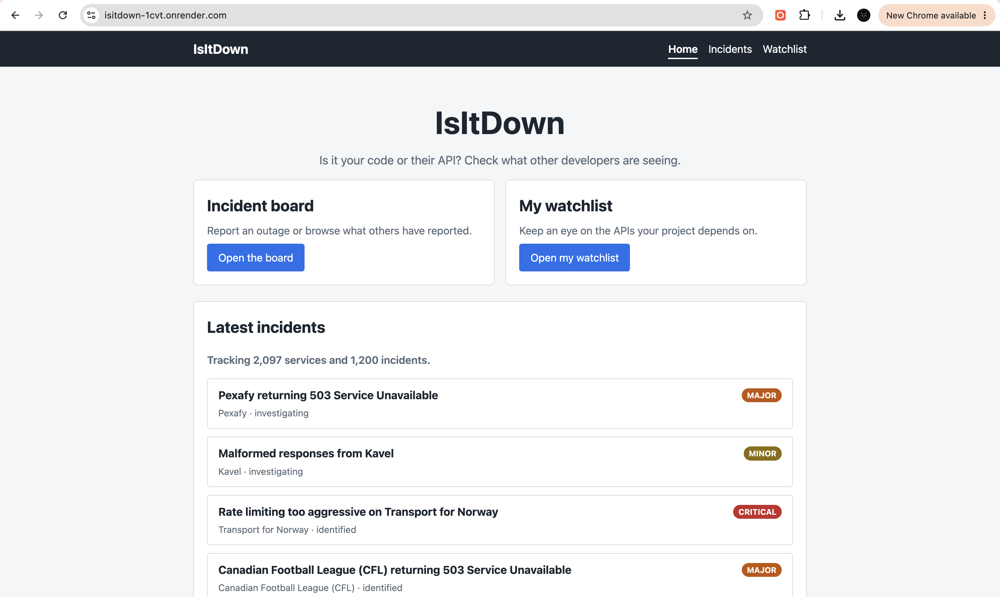
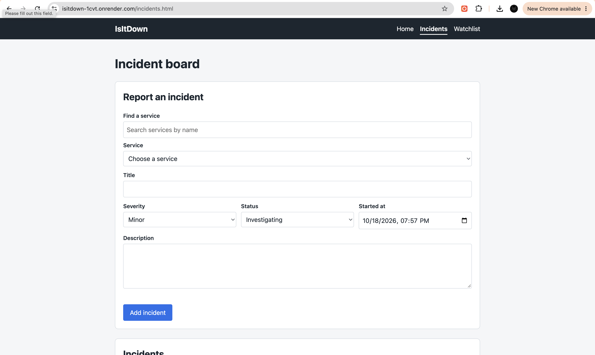

# IsItDown

A community outage board for public APIs. Browse a catalog of public APIs, then report incidents against them and keep a watchlist of the APIs your project depends on.

**Live site:** [https://isitdown-1cvt.onrender.com/](https://isitdown-1cvt.onrender.com/)

**Authors:** Rishabh Tiwari, Dins Patel

**Class:** [Web Development (Online, Fall 2026)](https://johnguerra.co/classes/webDevelopment_online_fall_2026/)

## Objective

Build a full-stack web app with Node, Express, and MongoDB (native driver, no Mongoose) and a client-side rendered vanilla JavaScript frontend. The app has three collections:

- `services`: a read-only catalog of 2,000+ public APIs seeded from the [public-apis](https://github.com/public-apis/public-apis) dataset.
- `incidents`: user-reported outages with full create, read, update, and delete support (Rishabh).
- `watchlist`: the services a developer is tracking, each with a status (`watching` or `worked around`) and notes. One entry per service, with full create, read, update, and delete support (Dins).

## Design document

See the [design document (PDF)](docs/DesignDoc.pdf) for the project description, user personas, user stories, and design mockups.

## Screenshot

### Home



### Incident board



## Tech

- Node.js 20.6+ (uses `node --env-file`, so there is no dotenv)
- Express
- MongoDB Node.js driver
- Vanilla ES6 modules and `fetch` on the client
- ESLint and Prettier

## Project structure

```
db/connection.js        Single shared MongoClient, exports getDb()
lib/pagination.js       Pagination helpers
routes/services.js      GET /api/services
routes/incidents.js     /api/incidents CRUD
routes/watchlist.js     /api/watchlist CRUD
scripts/                Database seed scripts
public/index.html       Landing page
public/incidents.html   Incidents page
public/watchlist.html   Watchlist page
public/js/              Client modules (api, dom, nav, service picker, one per page)
public/css/             One stylesheet per module
server.js               Express app
```

## Build instructions

1. Clone the repository and install dependencies:

   ```bash
   npm install
   ```

2. Create your environment file and fill in your MongoDB connection details:

   ```bash
   cp .env.example .env
   ```

3. Seed the database (downloads the public-apis dataset, then generates 1,200 incidents and 1,200 watchlist items):

   ```bash
   npm run seed
   ```

4. Start the server and open [http://localhost:3000](http://localhost:3000):

   ```bash
   npm start
   ```

Other scripts: `npm run seed:services`, `npm run seed:incidents`, `npm run seed:watchlist` (each collection on its own; incidents and watchlist need services seeded first), `npm run lint`, and `npm run format`.

## API

| Method | Path                       | Notes                                               |
| ------ | -------------------------- | --------------------------------------------------- |
| GET    | `/api/services`            | Query: `search` (name), `category`, `page`, `limit` |
| GET    | `/api/services/categories` | List of categories                                  |
| POST   | `/api/incidents`           | Validated body, returns 201                         |
| GET    | `/api/incidents`           | Query: `serviceId`, `severity`, `page`, `limit`     |
| GET    | `/api/incidents/:id`       | 404 if missing                                      |
| PUT    | `/api/incidents/:id`       | Validated body, 404 if missing                      |
| DELETE | `/api/incidents/:id`       | Returns 204, 404 if missing                         |
| POST   | `/api/watchlist`           | Validated body, returns 201, 409 if already watched |
| GET    | `/api/watchlist`           | Query: `serviceId`, `status`, `page`, `limit`       |
| GET    | `/api/watchlist/:id`       | 404 if missing                                      |
| PUT    | `/api/watchlist/:id`       | Validated body, 404 if missing, 409 on duplicate    |
| DELETE | `/api/watchlist/:id`       | Returns 204, 404 if missing                         |

## GenAI use

Generative AI (Claude) was used for some assistance with code writing. All code was reviewed by hand, run, and tested by the authors. The design document, presentation, and all other written materials were written by the authors.

## License

[MIT](LICENSE)
