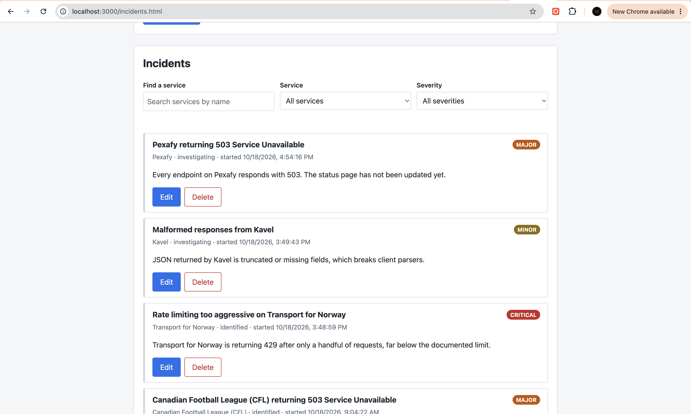

# IsItDown

A community outage board for public APIs. Browse a catalog of public APIs, then report, track, edit, and resolve incidents against them.

**Author:** Rishabh Tiwari
**Class:** [Web Development (Online, Fall 2026)](https://johnguerra.co/classes/webDevelopment_online_fall_2026/)

## Objective

Build a full-stack web app with Node, Express, and MongoDB (native driver, no Mongoose) and a client-side rendered vanilla JavaScript frontend. The app has two collections:

- `services`: a read-only catalog of 1,500+ public APIs seeded from the [public-apis](https://github.com/public-apis/public-apis) dataset.
- `incidents`: user-reported outages with full create, read, update, and delete support.

## Screenshot



_Screenshot placeholder: add `docs/screenshot.png` after running the app._

## Tech

- Node.js 20.6+ (uses `node --env-file`, so there is no dotenv)
- Express
- MongoDB Node.js driver
- Vanilla ES6 modules and `fetch` on the client
- ESLint and Prettier

## Project structure

```
db/connection.js        Single shared MongoClient, exports getDb()
lib/pagination.js       Pagination helpers
routes/services.js      GET /api/services
routes/incidents.js     /api/incidents CRUD
scripts/                Database seed scripts
public/incidents.html   Incidents page
public/js/              Client modules (api, dom, service picker, incidents page)
public/css/             One stylesheet per module
server.js               Express app
```

## Build instructions

1. Clone the repository and install dependencies:

   ```bash
   npm install
   ```

2. Create your environment file and fill in your MongoDB connection details:

   ```bash
   cp .env.example .env
   ```

3. Seed the database (downloads the public-apis dataset, then generates 1,200 incidents):

   ```bash
   npm run seed
   ```

4. Start the server and open [http://localhost:3000/incidents.html](http://localhost:3000/incidents.html):

   ```bash
   npm start
   ```

Other scripts: `npm run lint` and `npm run format`.

## API

| Method | Path                       | Notes                                               |
| ------ | -------------------------- | --------------------------------------------------- |
| GET    | `/api/services`            | Query: `search` (name), `category`, `page`, `limit` |
| GET    | `/api/services/categories` | List of categories                                  |
| POST   | `/api/incidents`           | Validated body, returns 201                         |
| GET    | `/api/incidents`           | Query: `serviceId`, `severity`, `page`, `limit`     |
| GET    | `/api/incidents/:id`       | 404 if missing                                      |
| PUT    | `/api/incidents/:id`       | Validated body, 404 if missing                      |
| DELETE | `/api/incidents/:id`       | Returns 204, 404 if missing                         |

## GenAI use

Generative AI (Claude) was used to help scaffold the project structure, write the seed scripts, Express routes, and frontend modules, and draft this README. All generated code was reviewed, run, and tested by the author.

## License

[MIT](LICENSE)
